# DynaLoop:Attention-Stability-Driven Adaptive KV Budget Allocation across Loops

**循环式语言模型的动态自适应逐 $(loop,\ layer)$ KV 缓存预算分配**

循环深度（looped / recurrent-depth）语言模型复用同一组权重迭代执行 $T$ 次，
其 KV 缓存由此形成 $T \times L$ 个相互独立的缓存单元。DynaLoop 将预算分配的
基本单位由 layer 细化为 $(loop,\ layer)$。

本文件记录两部分内容：**Ouro-1.4B 上跨循环注意力演化的实证分析**，以及
**DynaLoop 与 FullKV / DynamicKV / FlashLoop 的对比评测结果**。

---

## 目录

- [实证分析：注意力如何沿循环演化](#实证分析注意力如何沿循环演化)
- [实测分配特性](#实测分配特性)
- [实验结果](#实验结果)
- [与既有方法的关系](#与既有方法的关系)
- [已知局限](#已知局限)
- [引用](#引用)

---

## 实证分析：注意力如何沿循环演化

DynaLoop 的设计不依赖先验假设，而是直接源于对循环式模型的观测。以下分析在
Ouro-1.4B（4 循环 × 24 层，共 96 个注意力模块）上完成，样本取自正式评测所用的
prompt（约 2K token，6-shot），记录末位 prompt token（即决定首个生成 token 的
query）在**每个** $(loop,\ layer)$ 上对全部 key 的注意力分布。统计量为 25 个
样本（NIAH-Multi × 6、GSM8K × 7、MATH-500 × 12）的聚合；全部图表可由
`scripts/attn_report_figs.py` 复现。

### 1. 全景：同一图案被四个循环复用

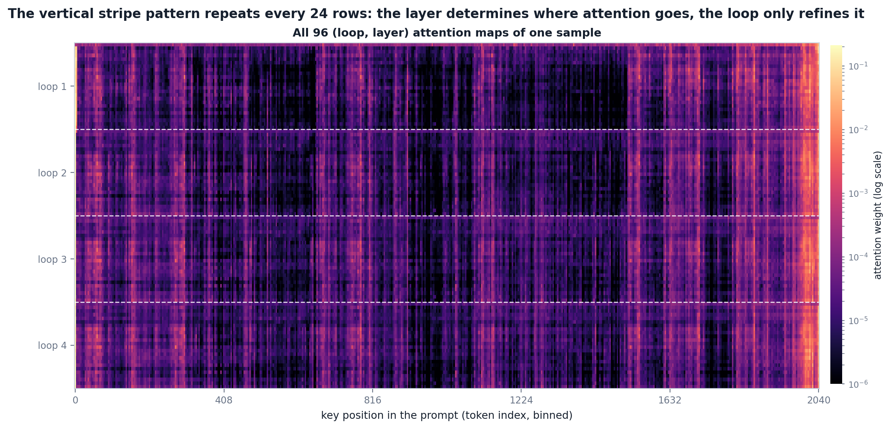

图中每一行是一个 $(loop,\ layer)$ 模块的注意力分布（共 96 行），每一列是一个
key 位置。纵向条纹每 24 行重复一次——**决定注意力图案的是层，而不是循环**；
循环只是在同一张底片上逐次微调。

### 2. 末层视角：四条曲线几乎重合

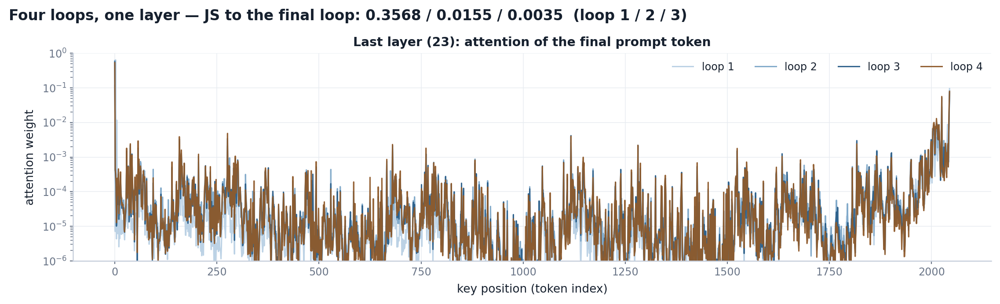

取最后一层（layer 23）的分布逐位置比较：loop 2–4 与末次循环的 JS 散度分别为
0.0155 与 0.0035 nats，比 loop 1（0.3568）低一至两个数量级。作为尺度参照，
同一循环内首层与末层的分布距离为 0.11——后者才是"真正不同"的分布。

### 3. 单头视角：第二个循环之后冻结

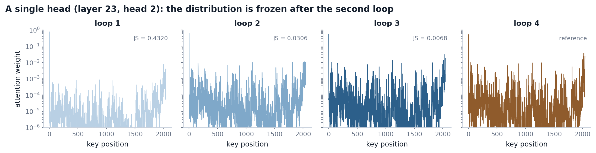

单个注意力头（layer 23, head 2）呈现同一规律：loop 2 之后分布基本冻结。

### 4. 距离矩阵的块结构

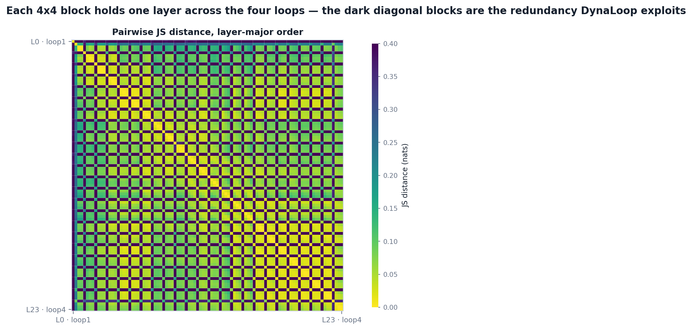

将 96 个模块按 layer-major 排列做两两 JS 距离：每个 4×4 小块是同一层在四个
循环之间的距离，明显比块外区域暗——同层跨循环高度冗余，正是 DynaLoop 只对
后 $T-K$ 个循环做预算分配的立足点。

### 5. 量化：收敛是普遍规律

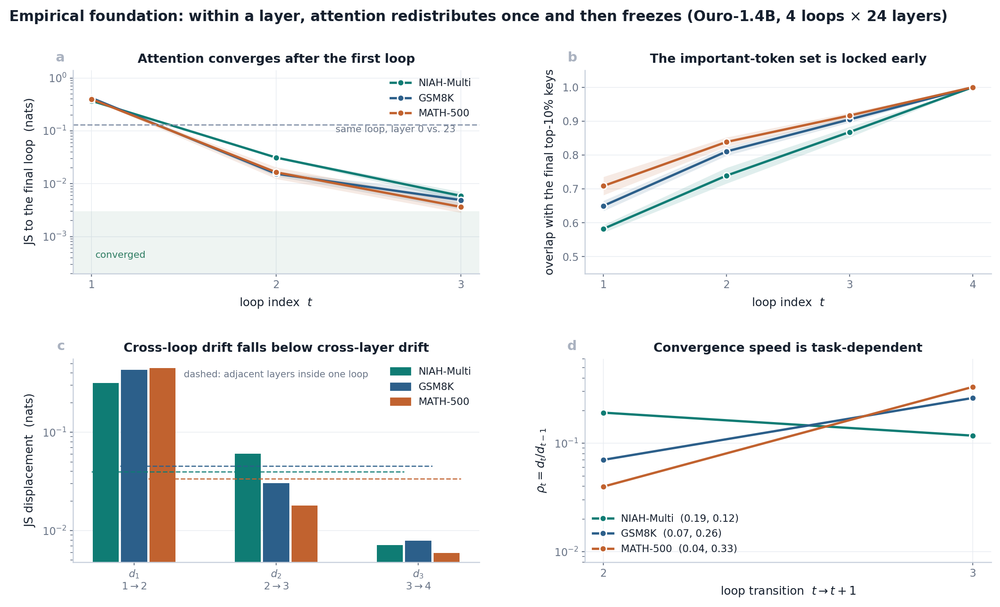

跨 25 个样本的聚合统计（均值 ± 标准差）：

- **位移单调衰减**（图 a）：以末次循环为参照的同层 JS 散度，loop 1 为
  0.37–0.42，loop 2 降至 0.015–0.031，loop 3 降至 0.004–0.006 nats。
- **重要 token 集合先于分布锁定**（图 b）：各层 top-10% 高权重 key 与末次循环
  的重合率由 loop 1 的 58–71% 升至 loop 2 的 74–84%、loop 3 的 87–92%。
- **跨循环漂移低于跨层漂移**（图 c）：自 loop 2 起，同层相邻循环间漂移
  （$d_2$、$d_3$）已低于同一循环内相邻层间漂移（0.034–0.046 nats）；
  而 loop 1→2 的位移（0.32–0.45 nats）超出后续全部漂移之和一个数量级。
- **收敛速度因任务而异**（图 d）：检索类任务（NIAH）在 loop 2→3 仍有
  $\rho_2 = d_2/d_1 = 0.19$ 的显著重排，推理类任务（GSM8K / MATH-500）已降至
  0.04–0.07。

### 6. 哪些 token 重要，何时被锁定

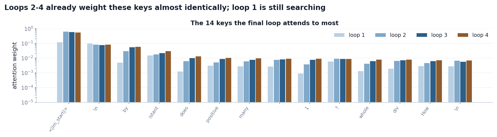

末次循环最看重的 14 个 key，在 loop 2、loop 3 中已获得几乎相同的权重；
只有 loop 1 的分布明显不同——它仍处于搜索阶段。

### 7. 稀疏性：注意力集中在极少数 token

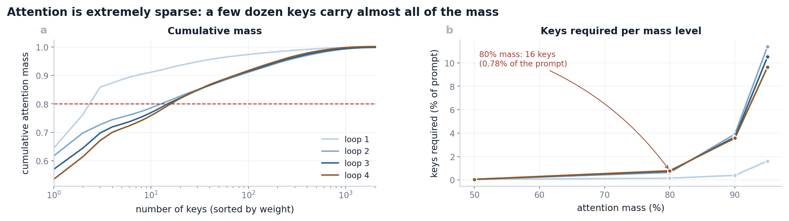

承载 80% 注意力质量只需约 16 个 key（占 prompt 的 0.78%）。被丢弃的低权重
token 在后续循环中对注意力输出几乎无贡献，其 K/V 无需重新计算。

### 8. 收敛速度是任务属性，不是模型属性

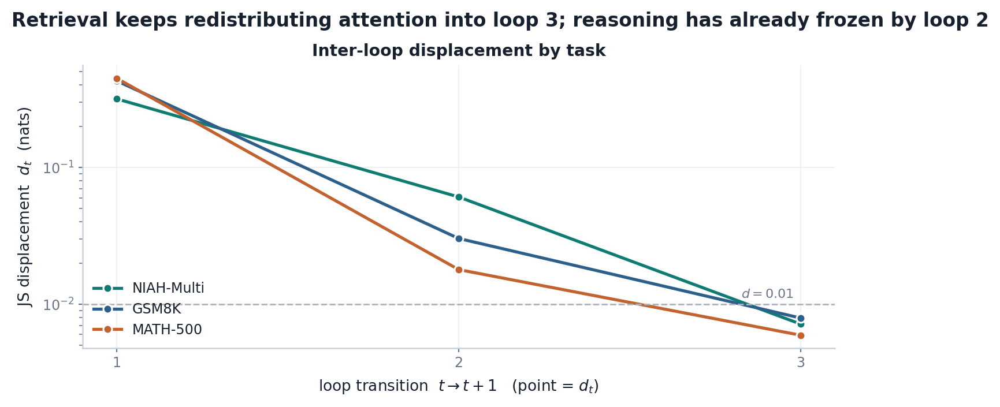

同一模型、同一套层，在检索任务上 loop 2→3 的位移仍达 0.06 nats 量级
（相当于一次完整的"重新寻找证据"），而在推理任务上 loop 2 前即已冻结。
**任何固定的逐循环预算表都无法同时适配两类任务**——这正是实测分配的
形状差异：

| 任务 | 方法 | Acc | 平均保留率 | 逐循环保留率 | 分配形状 |
|---|---|---|---|---|---|
| NIAH-1024 | FullKV | 1.000 | 1.000 | 1.00 / 1.00 / 1.00 / 1.00 | 全保留 |
| | DynamicKV | 0.510 | 0.570 | 0.57 / 0.57 / 0.57 / 0.57 | 均匀 |
| | **DynaLoop** | **1.000** | 0.607 | 1.00 / 1.00 / 0.27 / 0.16 | 前松后紧 |
| GSM8K | FullKV | 0.770 | 1.000 | 1.00 / 1.00 / 1.00 / 1.00 | 全保留 |
| | DynamicKV | 0.760 | 0.570 | 0.57 / 0.57 / 0.57 / 0.57 | 均匀 |
| | **DynaLoop** | **0.740** | 0.382 | 1.00 / 0.17 / 0.19 / 0.17 | 早压后平 |

（Ouro-1.4B，n = 100，seed = 42。两条 DynaLoop 配置由同一分配器在不同任务上
**自动**给出，不含任何任务名或任务相关超参。）

NIAH 上均匀保留 57% 即损失 49 个百分点（检索证据在 loop 2 仍在移动，此时压缩
等于在搜索中途丢弃证据）；推理任务上同一预算几乎无损。收敛信号必须在线测定，
这正是 DynaLoop 以注意力位移驱动分配的直接动机。

### 9. 逐样本复现

25 个样本的逐项统计（JS 散度、top-10% 重合率、80% 质量所需 key 数、
跨循环/跨层漂移）见 [results/attn_samples.md](results/attn_samples.md)；
聚合 JSON 见 `results/attn_convergence.json`。

### 10. 结论 → 设计原则

1. **loop 1 不压缩**：loop 1→2 是一次大幅度注意力重分配，压缩该阶段会直接
   破坏重要 token 的搜索过程；
2. **后续循环按实测位移分配**：已收敛单元的 K/V 对输出几乎无贡献，可压缩至
   下限；
3. **分配律必须任务自适应**：以样本自身的 loop 1 位移为参照归一化，
   同一规则在检索与推理任务上自动给出不同形状。

---

## 实测分配特性

以下均为 Ouro-1.4B 在 $\kappa{=}0.5$、$\gamma{=}1.0$、$f{=}0.10$ 下的实测值。

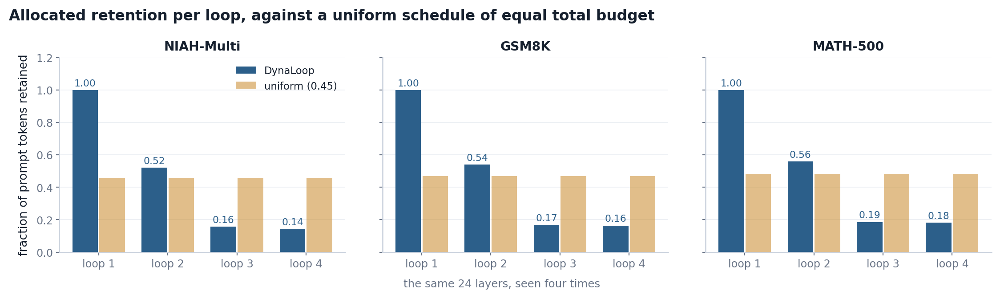

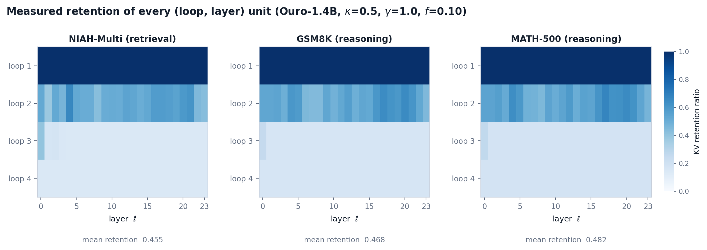

| 任务 | loop 1 | loop 2 | loop 3 | loop 4 | loop 2 内逐层 std |
|---|---|---|---|---|---|
| NIAH-Multi（检索） | 1.000 | 0.521 | 0.156 | 0.143 | 0.061 |
| GSM8K（推理） | 1.000 | 0.540 | 0.168 | 0.164 | 0.061 |
| MATH-500（推理） | 1.000 | 0.559 | 0.186 | 0.182 | 0.059 |

逐循环保留率非均匀，且与等总量预算的均匀分配显著不同；loop 2 内部逐层标准差
达 0.06 量级——逐 $(loop,\ layer)$ 的差异完全由注意力测定，而非先验设定。

---

## 实验结果

**实验设置。** Ouro-1.4B；单卡 RTX 4070 Laptop（8 GB）；n = 100；seed = 42；
few-shot prompt 约 1000 token；生成上限 512 token。KV 占用以 bf16 计入 K、V
两项（96 单元合计），并排除 padding。ARC-Challenge 与 HellaSwag 另有
**严格对齐 Ouro / FlashLoop 官方协议**的 n = 300 评测（见对应小节，
25-shot / 10-shot 长度归一化准确率），评测子集由 `seed = 42` 无放回抽样得到，
同一任务内所有方法共用同一子集（配对比较）。

### 长上下文检索 · NIAH-Multi（1K 上下文，16 根针）

| 方法 | Acc ↑ | 保留率 | KV/样本 (MiB) ↓ |
|---|---|---|---|
| FullKV | 1.000 | 1.000 | 768 |
| DynamicKV（ρ = 0.55） | 0.520 | 0.570 | 438 |
| DynaLoop（κ = 1.0, γ = 1.0, f = 0.10） | 1.000 | 0.607 | 466 |
| **DynaLoop（κ = 0.5, γ = 1.0, f = 0.10）** | **1.000\*** | **0.455** | **349** |

\* 该行 Acc 与保留率为小样本（n = 4）验证值；KV 由实测保留率折算
（本表内其余行亦满足 KV = 保留率 × FullKV）。

DynamicKV 在保留 57.0% token 的条件下检索精度降至 0.520，而 DynaLoop 在保留
45.5% token 的条件下仍维持 1.000：**保留哪些 token 比保留多少 token 更为关键**。

### 数学推理 · GSM8K 与 MATH-500

| 方法 | GSM8K Acc ↑ | MATH-500 Acc ↑ | KV/样本 (MiB) ↓ | KV 节省 |
|---|---|---|---|---|
| FullKV | 0.770 ± 0.042 | 0.500 ± 0.050 | 863 / 1002 | — |
| DynamicKV（ρ = 0.55） | 0.760 ± 0.043 | 0.440 ± 0.050 | 496 / 571 | −42.6% / −43.0% |
| FlashLoop（论文报告†） | 0.796 | 0.654 | —（峰值 KV 5.85×↓） | ≈ −83% |
| **DynaLoop（κ = 0.5, γ = 1.0）** | **0.790 ± 0.041** | 0.430 ± 0.050 | **397 / 465** | **−54.1% / −53.6%** |

† FlashLoop 行引自其论文 Table 1（Ouro-1.4B：GSM8K 79.61 / MATH-500 65.40，对应
Original 78.77 / 65.80），采用全测试集与论文官方协议；其压缩手段为 4-bit 残差量化
加跨循环稀疏更新，KV 口径为**峰值 KV 缓存缩减**，与本表其余行的逐样本 bf16 字节
口径不同，故不列入同一列，绝对分数亦不与本表直接比较。

在同一评测子集上（n = 100，seed = 42，配对比较），DynaLoop 于 GSM8K 以 54.1% 的
缓存节省取得与 FullKV 同等的精度（+2.0 个百分点，在 ±4.2 标准误内不显著），并在
相近保留率下优于 DynamicKV；MATH-500 的绝对损失主要源于 512 token 生成截断与
ChatML 协议（见下方"评测协议说明"），应按相对保持率解读。需指出，$\kappa$ 的
最优取值依赖任务，本工作未实现其在任务间的自适应。

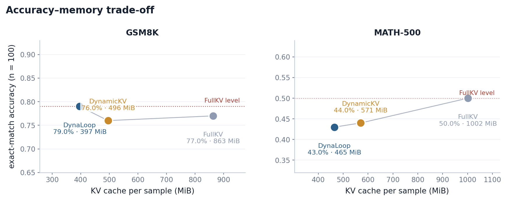

### 多选题推理 · ARC-Challenge 与 HellaSwag（n = 300，官方协议）

该口径对齐 Ouro / FlashLoop 官方评测：ARC-Challenge 25-shot、HellaSwag 10-shot，
均以 **长度归一化准确率（acc_norm）** 为指标（log-likelihood 排序，非生成式抽取）；
评测子集为 `seed = 42` 抽样所得 300 题，两方法配对比较。

| 数据集 | 方法 | Acc ↑（acc_norm） | KV/样本 (MiB) ↓ | 相对 FullKV |
|---|---|---|---|---|
| ARC-Challenge | FullKV | 0.600 ± 0.028 | 749 | — |
| | **DynaLoop（κ = 0.5, γ = 1.0）** | **0.600 ± 0.028** | **350** | **0.00 %** |
| HellaSwag | FullKV | 0.743 ± 0.025 | 571 | — |
| | **DynaLoop（κ = 0.5, γ = 1.0）** | **0.753 ± 0.025** | **273** | **+1.00 %** |

\* HellaSwag 的 DynaLoop 结果为 3 × 100 分片合并值（分片 acc_norm = 0.67 / 0.80 /
0.79；KV 为分片均值 261.9 / 278.2 / 277.9 MiB）。分片与整跑共用同一评测子集：
`eval_indices(300)[offset:offset+100]`，few-shot 池按同一 `seed = 42` 独立采样。

**本地 FullKV 基线已复现论文 Original**：GSM8K 0.780（论文 78.77）、ARC-C 0.600
（论文 60.92）、HellaSwag 0.743（论文 74.29），误差均 ≤ 1 分，故上述压缩后精度
可直接与论文基线对照。

关键观测：

- **ARC-C 完全无损**：DynaLoop 与 FullKV 均为 0.600，且 **300/300 逐样本判定一致
  （零翻转）**，KV 节省 53.2%（749 → 350 MiB）。
- **HellaSwag 亦无损**：DynaLoop 0.753 略高于 FullKV 0.743（+1.00 个百分点，
  在 ±2.5 标准误内不显著），KV 节省 52.3%（571 → 273 MiB）。
- 这两项任务均为 log-likelihood 评分（无需生成），对缓存扰动的鲁棒性高于生成式
  任务：**多选题上 DynaLoop 的压缩不造成精度损失**。

† **协议消融（ARC-C）**：多选题 few-shot 示例的答案写法会显著影响 acc_norm。
三种写法的 FullKV 结果分别为：索引数字 **0.413**、字母 **0.467**、**选项文本
0.600**（论文 60.92）。只有选项文本（与待打分的续写字符串一致）与官方
`MultipleChoiceTask.doc_to_target` 等价；此前按配置字面采用索引数字或字母会
低估约 14–20 个百分点。本表采用对齐后的文本协议。

### 长上下文扩展

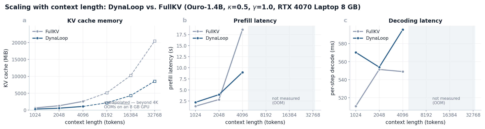

| 长度 | FullKV KV (MiB) | DynaLoop KV (MiB) | FullKV prefill (s) | DynaLoop prefill (s) |
|---|---|---|---|---|
| 1K | 638 | 287 | 1.33 | 2.21 |
| 2K | 1276 | 545 | 2.84 | 3.94 |
| 4K | 2558 | 1069 | 18.60 | **8.97** |

缓存节省稳定维持在约 55%。至 4K 时压缩后的注意力计算开销已被抵消，prefill
取得 2.1× 加速。1K 处 prefill 略慢，系 token 打分开销尚未被收益抵消所致。

### 评测协议说明

本工作 GSM8K 的 FullKV 基线与 Ouro 官方及 FlashLoop 报告值一致，而 MATH-500
基线偏低（0.500，对应 Ouro 官方 0.824 与 FlashLoop 0.658）。该差异源于评测协议
而非方法：本工作统一采用 `max_gen_toks=512`，致使 MATH-500 中 71/100 条解答被
截断（失败率 63%）；且统一使用 ChatML 模板。

故跨论文比较绝对分数不具意义，应比较**同协议下的相对保持率**
$\mathrm{Acc}_\mathrm{method} / \mathrm{Acc}_\mathrm{FullKV}$：

| 方法 | GSM8K | MATH-500 |
|---|---|---|
| DynamicKV | 98.7% | 88.0% |
| FlashLoop（相对其论文 Original†） | 100.1% | 99.4% |
| **DynaLoop** | **102.6%** | 86.0% |

† FlashLoop 的保持率按其论文 Table 1 的同协议配对值计算（79.61/78.77 与
65.40/65.80），与本表其余行（n = 100 子集、gen 512）非同一实验，仅作量级参照。

---

## 与既有方法的关系

| 方法 | 预算粒度 | 预算依据 |
|---|---|---|
| DynamicKV | layer | 窗口注意力 + 渐进式块更新 |
| ChunkKV | layer | 注意力（连续块选择） |
| PyramidKV / SnapKV | layer（金字塔 / 固定规则） | 先验设定 |
| FlashLoop | loop（4-bit 残差量化，不删 token） | — |
| **DynaLoop** | **$(loop,\ layer)$** | **跨循环 JS 位移** |

DynaLoop 与上述方法在决策层级上正交：其替换的是"每单元保留多少"这一层决策，
"保留哪些 token"仍可替换为 SnapKV / ChunkKV / PyramidKV 的选择器。
FlashLoop 以量化替代删除，二者可叠加。

---

## 已知局限

- 上下文长度超过 4K 的情形未在 8 GB 显存下实测（prefill 需物化 $[B,\ S,\ S]$
  注意力矩阵），图中该区间为解析外推。长上下文实测需接入 SDPA / FlashAttention。
- 短上下文（≤ 1K）下打分开销大于收益，prefill 劣于 FullKV。本方法面向长 prompt。
- $\kappa$ 存在任务依赖性，未在任务间实现自适应。

---

## 引用

```bibtex
@article{dynaloop2026,
  title   = {DynaLoop: Dynamic and Adaptive Per-(Loop, Layer) KV Cache
             Budgets for Looped Language Models},
  journal = {Under submission},
  year    = {2026}
}
```

若使用本仓库的 ChunkKV 块选择，请一并引用 ChunkKV；若与 FlashLoop 量化方案叠加，
请引用 FlashLoop。

## 许可

MIT，见 [LICENSE](LICENSE)。
